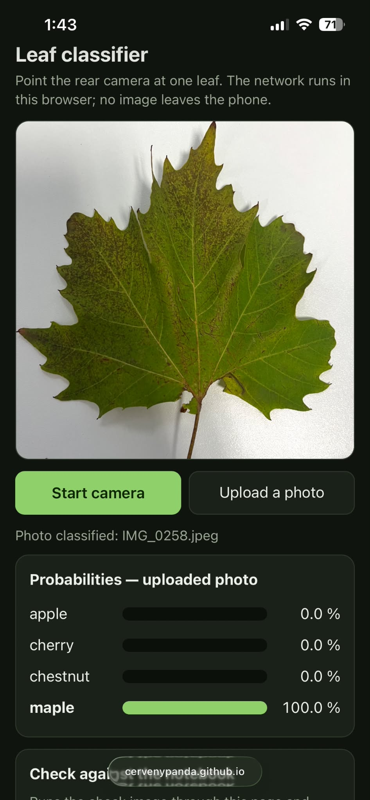

1. It runs on your phone

I opened the public GitHub Pages URL (https://cervenypanda.github.io/mlr-ex08/) on my phone using the QR code at the bottom of the page. I tested it on my iPhone 13 in Safari. After I pressed the Start camera button, the rear camera stream started and the page classified leaves live in the browser. No fixes were needed.

I did not test it on an Android phone.

2. The same numbers as the notebook

I uploaded check_image.jpg on the page and also pressed the built-in "Run the check" button, which compares the probabilities with check_expected.json. The upload shows the probabilities as percentages with one decimal; the six decimals below are from the check button. I did this twice: in Firefox on my Windows computer and in Safari on my iPhone 13.

class/check_expected.json/web page, computer/web page, iPhone Safari
apple/0.097147/0.097148/0.067095
cherry/0.887118/0.887117/0.919978
chestnut/0.015731/0.015731/0.012924
maple/0.000003/0.000003/0.000003

What I found. 
On the computer the page agrees with the notebook to three decimal places: the largest difference is 0.000001 (apple and cherry), well below 0.0005. On the iPhone it does not agree: apple differs by 0.030 and cherry by 0.033.

Why.
 check_image.jpg is a JPEG, and the browser has to decode it into pixels before the page can use it. Safari on the iPhone decodes it into slightly different pixels than the notebook did (the colour information in a JPEG is stored at half resolution and each decoder fills it in in its own way). The model is sensitive to that on such a small image, so the probabilities move by a few hundredths. The preprocessing and the model on the page are the same in both browsers.

What was fixed. The file check_image.png was added to the repository: a lossless copy of exactly the pixels the notebook got from check_image.jpg. The "Run the check" button now runs the image twice and shows both results, one from the PNG (the same pixels as in the notebook) and one from the JPEG as the browser decodes it; the verdict is taken from the PNG, so it tests the page and not the browser's JPEG decoder. On the computer both columns agree with the notebook (largest difference 0.000001). I did not repeat the new check on the iPhone.

The same effect applies to the live camera: small differences in the pixels change the probabilities by a few percent, so the numbers on the phone should not be read more precisely than that.

3. The preprocessing matches your model

I checked the preprocess function in index.html (lines 146 to 163).

- Crop: the frame is cropped to the central square using side = Math.min(width, height) with the offsets left = (width - side) / 2 and top = (height - side) / 2.
- Resize: the square is resized to 96 x 96 with ctx.drawImage(source, left, top, side, side, 0, 0, S, S), where S is input_size from model_info.json.
- Divide by 255: the pixels are read with ctx.getImageData(0, 0, S, S).data and scaled with rgba[4 * pixel + channel] / 255.
- Standardize: (value - info.mean[channel]) / info.std[channel], with the values from model_info.json (mean [0.485, 0.456, 0.406], std [0.229, 0.224, 0.225]).
- Channel order: the values go into a Float32Array channels first, in the order R, G, B (all R values, then all G, then all B; the alpha channel is skipped), and into an ort.Tensor of shape [1, 3, 96, 96]. The softmax is applied to the output logits.

This matches model_info.json and the transform of the notebook (ToTensor, then Normalize with the same mean and std).

One difference I found: the transform of the notebook does not resize anything, because the dataset was already cropped and resized to 96 x 96 by the teacher. On the page the resize is done by the browser's canvas, which may interpolate differently from the tool the teacher used, so a camera frame is not guaranteed to be resized exactly as the training photos were. The check image is not affected, because it already is 96 x 96. No fixes were needed.

4. Nothing leaves the phone

I inspected the code and the Network tab of the browser developer tools. No camera frame or uploaded image is sent anywhere: the camera frames are drawn onto a canvas in the page, and an uploaded file is opened through a local blob URL (URL.createObjectURL(file), line 289). The page contains no upload request of any kind.

The page loads only these URLs:

- https://cervenypanda.github.io/mlr-ex08/ — the HTML page itself
- https://cdn.jsdelivr.net/npm/onnxruntime-web@1.31.1/dist/ort.wasm.min.js — ONNX Runtime Web, the library that runs the network in the browser
- https://cdn.jsdelivr.net/npm/onnxruntime-web@1.31.1/dist/ort-wasm-simd-threaded.mjs — the loader of its WebAssembly part
- https://cdn.jsdelivr.net/npm/onnxruntime-web@1.31.1/dist/ort-wasm-simd-threaded.wasm — the WebAssembly code itself
- model_info.json and leaf_model.onnx from the same repository — the model's description and weights
- check_expected.json, check_image.png and check_image.jpg from the same repository — only after pressing "Run the check"

The QR code is an inline SVG inside index.html that was generated locally, so no external QR service is called. No fixes were needed.
